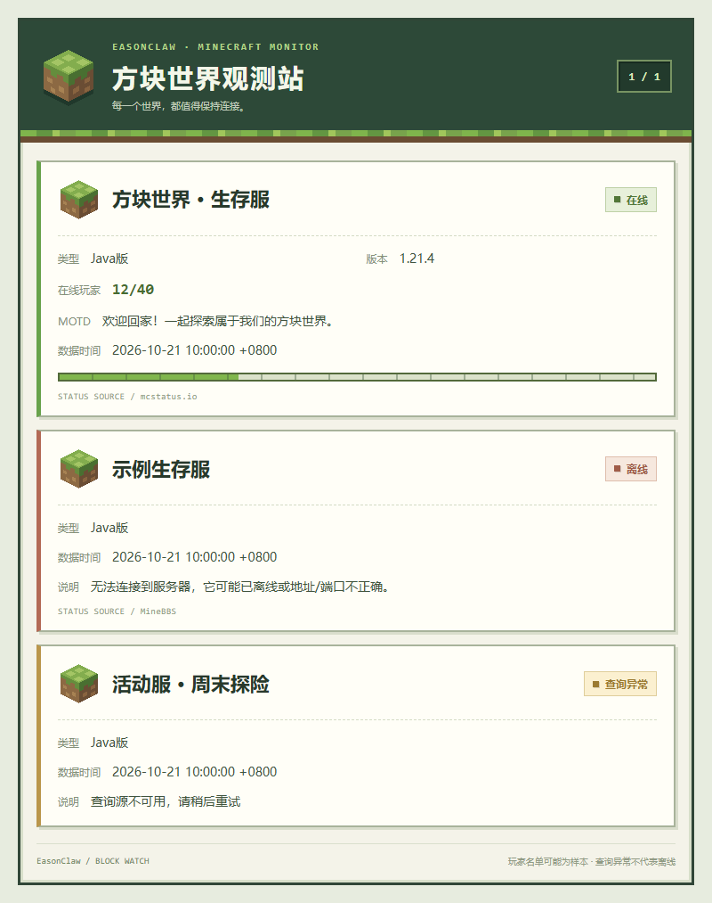

<p align="center"></p>

# EasonClaw · MC 服务器监控

[](https://github.com/Eason4869/astrbot_plugin_easonclaw_mc/actions/workflows/test.yml)
[](https://github.com/Eason4869/astrbot_plugin_easonclaw_mc/releases/latest)
[](LICENSE)

支持 Java / Bedrock、多服监控、**分群服务器绑定**和**MC 像素风图片卡片**。默认查询发图片，状态通知发文字；各群独立设置，渲染不可用时自动回退文字。当前版本 **0.3.0**，包名为 `astrbot_plugin_easonclaw_mc`。

| 能力 | 行为 |
|---|---|
| 分群隔离 | 按完整平台会话 UMO 授权，同群号不同机器人互不共享绑定 |
| 变化通知 | 上下线、查询异常恢复、人数和玩家样本变化；失败退避重试 |
| 图片查服 | 草方块、经验条、自动分页和内容高度截图，左下角署名 EasonClaw |
| 查询容错 | 双数据源故障切换、短时缓存、失败区分离线与查询异常 |

Logo 为原创草方块与三道爪痕组合；仓库提供可编辑的 [SVG](logo.svg) 和 AstrBot 使用的 [PNG](logo.png)。



## 安装与升级

1. 在 AstrBot WebUI 的插件管理中选择从链接安装，填入 **`https://github.com/Eason4869/astrbot_plugin_easonclaw_mc`**。也可以从 [Releases](https://github.com/Eason4869/astrbot_plugin_easonclaw_mc/releases/latest) 下载安装 ZIP 上传安装；手动解压时，将其中的 `astrbot_plugin_easonclaw_mc` 放入 `data/plugins`，保留模板等资源。旧用户先阅读下方迁移步骤。
2. 运行环境为 **Python >=3.10、AstrBot >=4.10.4**。插件仅依赖 `aiohttp>=3.9,<4`，由 AstrBot 安装依赖；图片复用 AstrBot 已配置的文转图服务，无需额外进程。文转图服务不可用时仍能文字查服。
3. WebUI 配置 `server_entries`，每台建议填写固定 `key`，例如 `survival`。Bedrock 常用端口 **19132**，Java 常用 **25565**；请填写服务器实际端口。
4. 使用 **AstrBot 管理员账号**在目标群发送 `/mc 订阅 survival`。同一群可订阅多台，同一服务器可被多群订阅。
5. 群友发送 `/mc 查询`。监控默认随插件初始化启动，也可由管理员执行 `/start_server_monitor`。

服务器、群绑定和展示设置也可全部在 WebUI 编辑。修改后重载插件生效。命令修改的分群配置会调用 AstrBot 的 `save_config()` 保存，重启后保留。

### 从旧包名迁移

**0.3.0 更换了插件标识，安装新包不会自动继承旧包配置。** AstrBot 按实际插件目录名读取 `data/config/<插件目录名>_config.json`；配置不保存在插件源码目录内。

1. 在 WebUI 停用旧版 Minecraft 监控插件，备份原配置。旧文件通常是 `data/config/astrbot_plugin_minecraft_multy_monitor_config.json`；如果旧插件目录为 `astrbot_plugin_minecraft_multi_monitor`，则对应 `data/config/astrbot_plugin_minecraft_multi_monitor_config.json`，以实际目录为准。不要同时运行新旧插件，避免指令冲突和重复通知。
2. 安装新包，先停用新插件，再将旧配置中的 `server_entries`、`group_entries`、全局设置和 `display_options` 导入新插件配置。也可在停止 AstrBot 后，将备份复制为 `data/config/astrbot_plugin_easonclaw_mc_config.json`；若目标文件已有有效配置，先备份并合并，避免覆盖。
3. 启用新插件并确认 WebUI 中的服务器和群绑定。原有固定 key、完整 UMO 及字段结构兼容，无需重新订阅；旧 `target_group` 仍按下文规则迁移。
4. 在各群执行 `/mc 列表` 和 `/mc 查询`，确认权限与图片署名，再恢复自动监控。确认新包工作正常后移除旧代码目录，保留配置备份。

迁移仅涉及插件名称和配置文件归属，0.2.1 的五项修复全部保留，详见 [CHANGELOG](CHANGELOG.md)。

## 指令

| 指令 | 用途 | 权限 |
|---|---|---|
| `/mc 帮助` | 查看指令 | 所有人 |
| `/mc 列表` | 查看本群已绑定的启用服务器 | 本群用户 |
| `/mc 查询` | 查询默认服务器；未设默认则查询本群所有绑定 | 本群用户 |
| `/mc 查询 survival` | 指定服务器 key 或唯一名称 | 本群用户 |
| `/mc 查询 survival text` | 本次使用文字；也支持 image、图片、文字 | 本群用户 |
| `/mc 订阅 survival` | 绑定服务器至当前群 | AstrBot 管理员 |
| `/mc 退订 survival` | 取消当前群绑定 | AstrBot 管理员 |
| `/mc 默认 survival` | 设置本群默认查询服务器 | AstrBot 管理员 |
| `/mc 默认 全部` | 取消默认，恢复查询全部绑定 | AstrBot 管理员 |
| `/mc 样式 image` | 本群查询使用 image / text | AstrBot 管理员 |
| `/mc 通知样式 text` | 本群通知使用 text / image | AstrBot 管理员 |
| `/mc 通知 status` | all：全部变化；status：上下线与查询异常恢复；off：关闭通知 | AstrBot 管理员 |
| `/mc 本群` | 获取完整 UMO 和订阅 key，供 WebUI 填写 | AstrBot 管理员 |
| `/start_server_monitor` | 启动全局监控 | AstrBot 管理员 |
| `/stop_server_monitor` | 停止全局监控及待启动任务 | AstrBot 管理员 |
| `/重置监控` | 清空检测缓存；原先运行时继续监控 | AstrBot 管理员 |
| `/查询` | 兼容旧命令，同样按本群绑定过滤 | 本群用户 |

这里的管理员指 **AstrBot 配置的机器人管理员**，不是自动认可的 QQ 群管理员。管理员在群内查询也按本群绑定过滤；管理员私聊可查看全局启用服务器，普通用户私聊不能查服。名称包含空格时请使用 key。

## 分群配置

服务器定义与群订阅分开：`server_entries` 保存地址和检测间隔，`group_entries` 保存每个群可以访问哪些服务器。采集不按群重复执行，一台服务器的数据可以分发给多个群。

- `session` 必须使用完整 **UMO**，格式为 `平台实例ID:GroupMessage:群ID`；平台实例 ID 由 AstrBot 分配，**不是机器人 QQ 号或固定 aiocqhttp 字符串**。优先使用 `/mc 订阅 key` 自动绑定，或 `/mc 本群` 获取实际值。
- 空订阅不授予任何服务器查询权限。相同群号在不同平台实例上保持独立。
- `default_server` 必须在该群订阅中；留空查询全部。默认服务器暂时禁用时自动查询该群其余启用服务器。
- 暂时禁用服务器不会删除群绑定，重新启用后恢复；也可直接 `/mc 退订 key` 移除已禁用服务器。删除服务器前先删除相关群订阅，避免无效 key 阻止配置加载。
- `key` 重复、端口越界、无效类型和无效群绑定会明确报错，不会带着错误配置继续运行。没有填写 key 时按类型、地址和端口生成稳定标识，不随排序或改名而变化；更换地址会生成新标识，建议始终显式填写固定 key。

完整配置见 [config.example.json](config.example.json)。示例地址、群号和 `qq-main` 均为占位内容，需要替换；不要将整个示例直接覆盖生产配置。

### 旧版 target_group 迁移

`target_group` 保留兼容。仅在未配置任何群绑定，且 AstrBot 中存在唯一 OneBot/AIOCQHTTP 实例时，自动转换为该实例的完整 UMO 并绑定当前启用服务器。多实例无法确定投递账号时不会猜测，请由管理员在目标群订阅。迁移完成后以 `group_entries` 为准，可清空旧字段。

## 查询与通知行为

- 默认 MineBBS，可切换 mcstatus.io。`enable_api_fallback` 默认开启：HTTP、网络或解析错误才尝试备用源；正常离线结果不切换。
- 按服务器设置检测间隔，默认继承全局值；建议 **30–60 秒**，最小 5 秒。接口有缓存和限流，频繁轮询无法保证实时数据。
- 同服请求加锁，三秒内复用成功结果；不同服务器最多三个并发请求，HTTP 连接复用。
- 连续两次离线才确认离线；连续两次查询失败进入黄色“查询异常”，不会把 API 故障误报成服务器离线。恢复后发送通知。
- 人数变化按前后人数报告；名单按**玩家样本**处理，人数相同时样本变化也能识别。轮询无法提供准确进出事件记录，名单为空不等于无人在线。
- 每个群和服务器保留最新一条待发通知，新变化替换旧变化。失败最多尝试三次，从失败完成时起等待 5 / 15 秒，排队超过五分钟后不再开始投递；总上限 200 项。成功群不重复发送，已退订或关闭通知的群不再投递。
- 待发通知只保存在内存，重启/重置会清除；平台超时但实际已发送时，重试仍可能重复。平台接口返回成功也不等于用户客户端已收取。
- 主动通知受 AstrBot 适配器支持限制，主要面向 OneBot；**QQ 官方接口不保证可主动群发**。已提交给平台的消息不能通过退订撤回。

## 图片卡片

- MC 像素草方块、草地边、经验条和冒险手记均由模板直接绘制，无外部素材或字体请求。[离线一言卡片示例](docs/images/status-offline-quote.png)。
- 图片页眉与左下角采用 **EasonClaw** 品牌；AstrBot 插件列表使用根目录 `logo.png`。
- 固定 800px 宽、按实际内容高度截图，解决短内容底部整屏空白。使用官方文转图服务支持的 `viewport_width=800`、`viewport_height=1` 和 `full_page=true`，模板也带视口 meta。[官方参数说明](https://github.com/AstrBotDevs/astrbot-t2i-service#api-endpoints)。自建旧版服务若不支持视口参数，需要更新其既有渲染服务。
- 每页最多四台服务器，单台查询自然显示为详情卡片；在线绿色、离线红色、查询异常黄色。
- 尊重全局 `display_options`，包括地址、版本、名单、更新时间和一言开关；关闭地址展示时不加入地址字段。
- 支持在线人数进度条；mcstatus.io 返回有效 PNG 图标时展示图标，否则使用默认标识。仅接受受限尺寸的内嵌 PNG，不加载上游任意外链。
- 相同卡片三十秒内复用，最多缓存三十二张。MOTD、名称、名单及一言都做 HTML 转义；长内容截断、换行。
- 图片渲染失败回退文字，图片通知发送失败也会尝试文字。图片通知阶段总预算 25 秒，含等待渲染锁；每次投递总上限 50 秒，保留文字发送时间。远程适配器在被动图片发送阶段发生的错误仍由 AstrBot 自身处理。
- 采集后、渲染后及每页输出前检查当前群授权。渲染期间退订会使含已撤销内容的图片页作废；重新查询可获取当前绑定结果。卸载插件会取消并等待渲染任务，关闭后不再产生图片结果。
- 使用 AstrBot HTML/Jinja2 渲染服务，不需要安装本项目的开发依赖。

## 开发验证

```powershell
python -m pip install -r requirements.txt pytest ruff
python -m pytest -q
python -m ruff check .
python -m ruff format --check .
python -m compileall -q main.py minecraft_multi_monitor scripts tests
python scripts/package_plugin.py
python scripts/verify_package.py
```

测试使用 AstrBot 边界替身，业务模块正常执行；HTTP 连接复用使用本地 127.0.0.1 服务验证。它们不替代真实 AstrBot 和 QQ 联调。

如需重新生成预览，在独立开发虚拟环境安装 `requirements-dev.txt`，本机有 Edge 时执行：

```powershell
python scripts/preview_cards.py
python scripts/build_logo.py
```

预览是固定模拟数据，使用生产截图选项，检查中文、长文本、横向溢出、脚本转义、底部空白、分页、品牌和不同初始视口；结果写入 `docs/images/preview-report.json`。Logo 导出与本地预览使用 Edge，不是运行插件的依赖。CI 在 Python 3.10 / 3.12 / 3.13 上执行回归、静态检查与安装包校验。真实部署仍需检查文转图服务、字体、平台主动发送能力和群发言权限。

打包结果位于 `dist/astrbot_plugin_easonclaw_mc-v0.3.0.zip`，附逐文件 `manifest-v0.3.0.json` 和 `SHA256SUMS.txt`。安装 ZIP 只含运行文件、Logo、说明及两张示例图；完整测试与开发脚本在仓库源码中。

### 常见问题

- **列表为空或提示未绑定**：管理员在目标群 `/mc 订阅 key`；检查 UMO 的平台实例 ID，不要只填写群号。
- **只有文字，没有图片**：检查 AstrBot 文转图服务日志与连通性。插件会自动回退文字；短图底部有大块空白时检查渲染服务是否支持视口参数。
- **查服正常但收不到通知**：先确认监控已启动、本群通知不是 `off`，再查看适配器主动发送能力和插件发送日志。只有确认的变化才触发通知。
- **换名后配置为空**：按上面的旧包迁移步骤导入配置，重命名并不会自动转移 AstrBot 保存的配置文件。

## 项目结构

- `main.py`：插件生命周期、指令和采集协调
- `minecraft_multi_monitor/config.py`、`models.py`：配置校验与数据模型
- `clients.py`：双 API、连接复用与故障切换
- `monitoring.py`：状态比较及文字格式化
- `subscriptions.py`：分群授权与配置保存
- `delivery.py`、`services.py`：通知队列及平台投递
- `rendering.py`、`templates/status.html`：分页卡片与图片缓存

## 来源

本项目由 **Eason4869** 维护，基于 [XiaolongYang-HZAU/astrbot_plugin_minecraft_multy_monitor](https://github.com/XiaolongYang-HZAU/astrbot_plugin_minecraft_multy_monitor)（原作者 xlyang）改进。原作者参考了 [cryfly666/astrbot_plugin_apimcmc](https://github.com/cryfly666/astrbot_plugin_apimcmc)。保留原有 [AGPL-3.0 许可证](LICENSE)，改动范围见 [CHANGELOG](CHANGELOG.md) 和 [NOTICE](NOTICE)。

本项目为社区插件，与 Mojang / Microsoft 无隶属关系。
